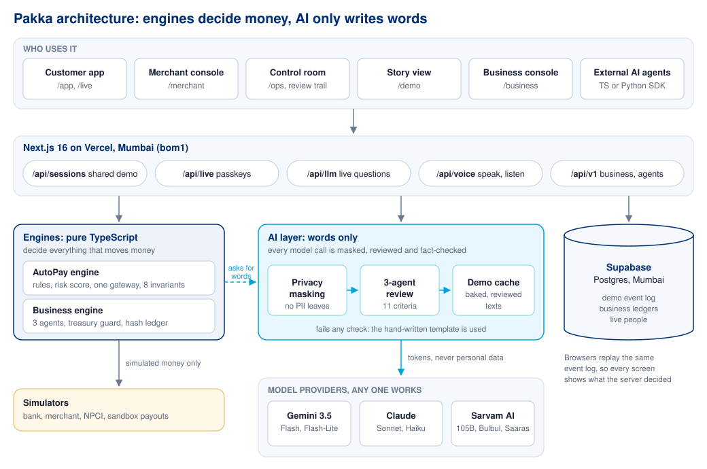
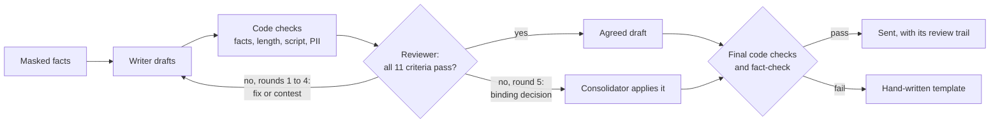

# Pakka

**An AI teammate for UPI AutoPay that asks before the money moves.** Built for the Paytm Build for India AI Hackathon, Problem Statement 3 (Autonomous AI Teammates).

**Live: [paytm-hack-puce.vercel.app](https://paytm-hack-puce.vercel.app)**

| Try it | Link |
|---|---|
| The 3-minute story (start here) | [/demo?grid=1](https://paytm-hack-puce.vercel.app/demo?grid=1) |
| Customer phone app | [/app](https://paytm-hack-puce.vercel.app/app) |
| Merchant console (PadhoAI) | [/merchant](https://paytm-hack-puce.vercel.app/merchant) |
| Control room, flight recorder and review trail | [/ops](https://paytm-hack-puce.vercel.app/ops) |
| Pakka for Business (simulation) | [/business](https://paytm-hack-puce.vercel.app/business) |
| Pakka for Business, live with passkeys | [/business/live](https://paytm-hack-puce.vercel.app/business/live) |
| Pakka live, for your own AutoPays | [/live](https://paytm-hack-puce.vercel.app/live) |

All merchants and people in the demo are fictional. No real money moves anywhere.

## The problem

One UPI PIN at setup approves every future AutoPay charge. A ₹1 trial quietly becomes ₹599 a month, the bank SMS names a company the customer has never heard of, and the refund path bounces between app, bank and merchant. About 2 crore AutoPay mandates are revoked every month (Sept 2025).

## What Pakka does

Pakka works in the 24 hours before a charge. It asks before an unwanted charge leaves, helps a wanted charge go through, and refunds under the merchant's own rules. The AI only writes words: every rupee moves through one gateway with a rule ID, and the demo ends with **₹1,59,334 stopped, ₹55,016 collected and ₹0 moved without a rule**.

| Results | |
|---|---|
| Unwanted charges stopped before they left | ₹1,59,334 |
| At-risk charges that still went through | ₹55,016 |
| Money moved without a rule | ₹0 |
| AI messages checked by a second agent in the story | 609, 1.5 rounds on average |
| Languages in the customer app | 24 (voice in 11, spoken questions in 23) |
| Unit tests | 270 passing |
| Red-team attacks that got through | 0 of 14 (consumer), 0 of 3 (model), 0 of 46 (business) |

## Features

### AutoPay teammate (the PRD demo)
- **Deterministic engine:** a world of 6,000 users, 14 merchants and 9,400 mandates from seed 2711; state is a replay of the event log; the 3-minute story lands on the PRD's exact numbers every time.
- **One money gateway:** every action carries a rule ID and an idempotency key; eight invariants are checked after every step; a kill switch per scope.
- **Risk score per mandate:** trial jumps, unused apps, unknown company names and open incidents decide whether Pakka asks, tells or stays quiet.
- **Doosri Haan:** with the merchant's consent, a first charge after a trial needs a yes; no answer means no charge.
- **Skip, cheaper plan, pause, cancel:** neutral choices in a fixed order; pause and cancel need the UPI PIN, skip does not.
- **Failed-charge help:** retries only in NPCI's off-peak windows, at most 4 attempts.
- **Refunds under the merchant's own rules**, a fraud lane that never routes through the merchant, and a case file with a verified callback for the trust team.
- **Review Radar:** spots a spike in AutoPay complaints and sends the merchant a private alert.
- **Four surfaces:** the phone app, the merchant console, the control room with a flight recorder that explains every decision, and the story view.
- **Shared live demo across devices** through Supabase: open the story on a laptop and Sunita's app on a phone.

### Privacy masking
- Phones, UPI IDs, emails, bank accounts, IFSC, PAN, Aadhaar, card numbers, OTPs and PINs, and the customer's own name are replaced by tokens like `<PHONE_1>` before **any** model or voice call. No masking, no call.
- Amounts, dates, times, case IDs and the 1930 helpline are kept (an allowlist in code). OTPs and PINs are never put back.
- Questions are stored masked; the flight recorder shows counts only ("2 masked: phone, UPI ID").

### Three-agent review
- Every AI text a person reads (reminders, Pakka se poochho replies, case summaries, merchant alerts) is drafted by a **writer**, judged by a **reviewer** against 11 written criteria, and, after 5 rounds of disagreement, finalised by a **consolidator** applying the reviewer's binding decision.
- Code checks (facts, length, script, privacy) run before the reviewer and again on the final text; the reviewer can never pass a criterion the code failed. Anything that fails uses the hand-written template.
- The control room shows a **Review trail** for every message: verdicts per criterion per round, contests, final status and what was masked.

### 24 Indian languages and voice (Sarvam AI)
- Hindi, Hinglish and English are hand-written; 21 more languages are translated by Sarvam (Mayura and Sarvam Translate) and every line is checked before it shows.
- **Listen** reads Pakka's messages aloud with Bulbul; the mic in Pakka se poochho understands 23 languages with Saaras.

### Pakka live
- Anyone can sign up at `/live` with a passkey, add the AutoPays they really have (typed or pasted from a bank SMS) and let Pakka run on the real clock. Only money is simulated.

### Pakka for Business
- Three AI agents (payables, compliance, risk) plan vendor payouts in rupees but can never move money. A **treasury guard** releases a payout only for a receipt it verifies itself: three Ed25519 agent signatures, the people the amount needs (checker from ₹50,000, CFO from ₹5,00,000), the account on file, the exact amount after TDS, an unused nonce, caps, cooling and the release window. It fails closed.
- Story: a phishing email with a prompt injection asks for ₹4,19,905 to a new account; it is quarantined, the callback exposes it, and the real invoice is paid to the real account. 34 attacks in the simulation and 12 on a live ledger: 0 got through.
- Live mode with passkeys, a signed agent API (`/api/v1`), signed webhooks, a hash-chained ledger, an audit export and a **Python SDK**.

## Architecture



The engines decide everything that moves money; the AI layer only writes words, always masked first and reviewed before anyone reads them. The browser replays the same engine from the same event log, so every screen shows exactly what the server decided.

### How a text gets approved



## Tech stack

| Layer | Technology |
|---|---|
| Language | TypeScript (strict); Python for the Business SDK |
| Web | Next.js 16.4 (App Router, Cache Components), React 19.3 |
| Design | Tailwind CSS 4, Mukta font, lucide-react icons; works from a 390 px phone to a laptop |
| State and validation | zustand, Zod 4 |
| Database | Supabase Postgres in Mumbai (migrations `0001_init`, `0002_b2b`, `0003_live`) |
| Hosting | Vercel, region bom1 (Mumbai) |
| Language models | Gemini 3.5 Flash and Flash-Lite (free tier), Claude Sonnet and Haiku, Sarvam 105B |
| Indian-language AI | Sarvam Bulbul v3 (speech), Saaras v4 (listening), Mayura and Sarvam Translate |
| Cryptography and identity | @noble/curves and @noble/hashes (Ed25519, P-256, SHA-256), SimpleWebAuthn passkeys |
| Determinism | seedrandom (seed 2711), a synchronous SHA-256 for idempotency keys |
| Testing | Vitest (270 tests), Playwright (end-to-end story and a 39-step screenshot tour), Python unittest |
| Tooling | pnpm, tsx, ESLint |

## Run it locally

```bash
pnpm install
pnpm build && pnpm start      # or: pnpm dev
```

Open http://localhost:3000. Pick a surface or use the one-laptop grid (`/demo?grid=1`). To put Sunita's app on a phone, connect the phone to the same Wi-Fi and scan the QR on the home page. Nothing below is required: without keys the demo runs in each browser on hand-written templates.

### Environment variables

Copy `.env.example` to `.env.local`. All keys stay on the server.

| Variable | For |
|---|---|
| `NEXT_PUBLIC_SYNC=server`, `NEXT_PUBLIC_SUPABASE_URL`, `NEXT_PUBLIC_SUPABASE_ANON_KEY`, `SUPABASE_SERVICE_ROLE_KEY` | One shared demo across phone and laptop; Business and live storage |
| `LLM_PROVIDER` | `gemini`, `anthropic`, `sarvam` or `none` (otherwise whichever key is set) |
| `GEMINI_API_KEY`, `GEMINI_MODEL`, `GEMINI_MODEL_FAST` | Gemini (free): writer `gemini-3.5-flash`, reviewer and classifiers `gemini-3.5-flash-lite` |
| `LLM_API_KEY`, `LLM_MODEL`, `LLM_MODEL_FAST` | Anthropic instead |
| `SARVAM_API_KEY`, `SARVAM_MODEL` | Voice, listening, translation, 24 languages, bank SMS reading; Sarvam 105B as a chat model |
| `LLM_USE_DEMO_CACHE` | Serve texts baked by `pnpm bake:llm` (default on) |
| `PAKKA_SESSION_SECRET`, `PAKKA_ORIGINS`, `PAKKA_RP_ID` | Passkey sessions for `/live` and `/business/live` |
| `CRON_SECRET` | Protects `/api/live/cron` and `/api/v1/live/cron`, which move time when nobody is using the app |

### One shared demo across devices (free)

1. Create a free Supabase project and run `supabase/migrations/0001_init.sql` in its SQL Editor (`0002_b2b.sql` for Business live, `0003_live.sql` for Pakka live).
2. Set the Supabase variables above in `.env.local` and in Vercel.
3. `pnpm check:supabase` plays the whole story against the database and checks the numbers.

### Scripts

| Command | What it does |
|---|---|
| `pnpm test` | 270 unit tests: engine, gateway, invariants, red teams, masking, review loop, Sarvam, Business, live |
| `pnpm build && pnpm e2e` | Plays the 3-minute story in Chrome and checks the final counters |
| `pnpm tour` | 39-step screenshot tour of every screen (report in `docs/test-report`) |
| `pnpm bake:llm` | Writes and reviews every story text into `src/llm/demo-cache.json`; resumable |
| `pnpm try:review` | One reminder and one live question through the review loop |
| `pnpm bake:sarvam` | Translates the customer copy into 21 more languages |
| `pnpm sarvam:first-call` | One Sarvam call to check the key |
| `pnpm b2b:story` | Prints what happened to every invoice in the Business story |
| `pnpm b2b:live-demo`, `pnpm agents` | Sets up a Business company and runs reference agents against it |
| `pnpm b2b:verify <export.json>` | Verifies a signed Business ledger export offline |
| `pnpm test:python` | Tests the Python SDK |
| `pnpm check:supabase`, `pnpm check:live` | Plays the story against Supabase or the deployed site |

## Demo in three minutes

1. Open [/demo?grid=1](https://paytm-hack-puce.vercel.app/demo?grid=1) and press **Next moment**.
2. 8:58 PM: Review Radar opens INC-07. 9:06 PM: PadhoAI turns on "Charge only after the customer says yes".
3. 9:10 PM: Sunita's phone gets the Doosri Haan sheet. Tap **Listen**, choose "Is mahine skip karo". No PIN needed.
4. In the control room, open **Review trail** on her reminder: round 1 failed the Hindi script check, round 2 passed all 11 criteria.
5. Jump to 28 Oct, 6:05 PM. Rahul's retry waits for 9:30 PM, outside NPCI's peak hours. Ask Pakka a question with a phone number in it: the reply is reviewed, and the number never reaches the model.
6. Switch the language to Tamil or Bengali and tap **Listen**.
7. Open PAK-2311 to see Farhan's case and the verified callback.
8. Jump to 29 Oct, 6:00 AM: ₹1,59,334 stopped, ₹55,016 collected, 0 moved without a rule.
9. Close on [/business](https://paytm-hack-puce.vercel.app/business): the ₹4,19,905 phishing email is stopped, and the red team's 34 attacks all fail.

## Pakka for Business, live mode

People sign in and sign every approval with passkeys. Agents run outside the app and call the API with their own Ed25519 keys ([docs/AGENT_API.md](docs/AGENT_API.md); Python client and guide in [docs/BUSINESS_API_PYTHON.md](docs/BUSINESS_API_PYTHON.md)). Try it against `pnpm dev`:

```bash
pnpm b2b:live-demo
pnpm agents run
pnpm agents erp-demo erp v_1 --gstin=<printed GSTIN>
pnpm agents erp-demo erp v_1 --gstin=<printed GSTIN> --phish
pnpm b2b:live-demo approve
```

Or create your own company at `/business/live` with your own passkey, invite people by link, and register agents made with `pnpm agents keygen <name>`.

## Repository map

| Path | What is there |
|---|---|
| `src/engine`, `src/sim` | The AutoPay engine (pure TypeScript) and the bank, merchant and NPCI simulators |
| `src/b2b` | The Business engine: agents, treasury guard, ledger, policy, red team |
| `src/llm` | Prompts, schemas, fact-check, demo cache, model client; `src/llm/agents` holds the review loop and rubric |
| `src/lib/privacy` | Masking |
| `src/lib/server` | Shared sessions, Sarvam voice routes, Business and live servers |
| `src/copy` | Hand-written copy in Hindi, Hinglish and English, and the 21 translated languages |
| `src/components`, `src/app` | Screens and routes |
| `sdk/python` | Python client for the Business agent API |
| `supabase/migrations` | Database setup |
| `tests` | Unit, end-to-end and tour tests |
| `docs` | Decisions, agent API, Python guide, test report |

Decisions where the PRD is silent are recorded in [docs/DECISIONS.md](docs/DECISIONS.md).

## Not built yet

- Masking a spoken question's audio: it goes to Sarvam before it can be masked; the transcript is masked straight after.
- Pakka live in production needs `0003_live.sql` run in Supabase and a cron call with `CRON_SECRET`.
- Real bank payouts for Business (a sandbox bank by design), a console button to rotate an agent's API key, and passkeys tried on every phone platform.
- Real review data (reviews are synthetic) and Supabase Realtime (the screens poll).

## Team

Built by Sneha (GitHub sneharc16: the AutoPay engine and demo, privacy masking, the three-agent review) and Dhruv Dawar (GitHub dhruvdawar11: Pakka for Business, Sarvam languages and voice, Pakka live, the Python SDK).
