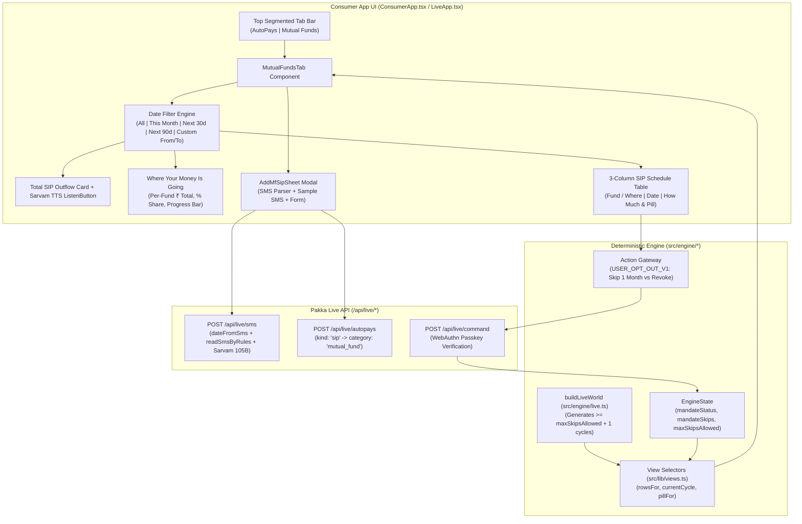
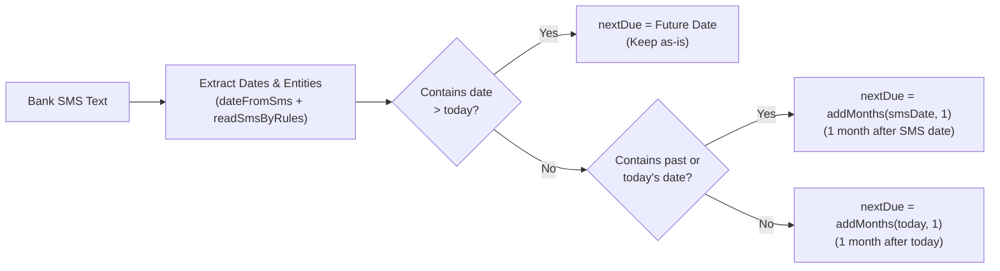
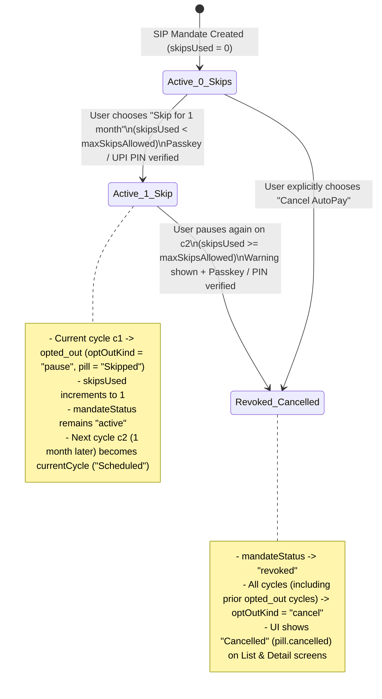

# Pakka for Mutual Funds (SIP): Product Requirements Document

Oct 31, 2026 · Dhruv Dawar · Branch `main`

---

## 1. Overview & Problem Statement

**Pakka for Mutual Funds (SIP)** is a dedicated consumer intelligence, cashflow visibility, and mandate governance module inside the Pakka Consumer App (`/app`, `/`, and `/live`). It gives retail investors complete clarity over **what amount is going where, when, and how much** across all their Systematic Investment Plan (SIP) UPI AutoPay mandates, paired with date-range filtering, bank SMS ingestion, multilingual voice summaries, and configurable 1-month skip / revocation guardrails.

### Problem

1. **Fragmented SIP Visibility:** Retail investors in India set up SIP UPI AutoPay mandates across multiple platforms (Paytm Money, Groww, Zerodha Coin, Kuvera, direct AMC portals). On bank statements and standard UPI AutoPay lists, these appear as cryptic legal entity names (e.g., `PPFAS Asset Management Pvt Ltd`, `Nippon Life India Asset Management Ltd`, `ICICI Prudential AMC`) mixed in with OTT subscriptions, electricity bills, and loan EMIs.
2. **Opaque Cashflow Outflow ("How much is going where?"):** Investors struggle to answer two simple questions for any given week, month, or quarter:
   - *How much total money is leaving my bank account for Mutual Fund SIPs in this date window?*
   - *What percentage and rupee amount is going to each fund house / scheme?*
3. **Accidental SIP bounces vs. Rigid Pausing:** When a user faces a temporary liquidity crunch in a single month, pausing an AutoPay mandate in conventional apps either halts the SIP indefinitely (hurting long-term compounding because the user forgets to unpause) or forces outright cancellation. Conversely, repeatedly skipping a mandate without guardrails leads to silent mandate abandonment.
4. **Cryptic Bank SMS Dates:** Bank mandate creation SMS messages often state the *registration date* (`created on 15-10-2026`) rather than the next debit date (`15-11-2026`), causing manual trackers to miscalculate the next installment cycle.

### Product Solution

- **Dedicated Mutual Funds Tab (`tab.mf`):** Separates wealth-building SIP mandates (`category === "mutual_fund"` / `kind === "sip"`) into a purpose-built tab inside the Consumer App while keeping them governed by the core Pakka deterministic engine.
- **Interactive Date Filters:** Preset date windows (**All dates**, **This month**, **Next 30 days**, **Next 3 months**) plus custom **From (`Se`)** and **To (`Tak`)** calendar date pickers that dynamically recompute total SIP outflow, per-fund allocation shares, and the installment schedule.
- **"Where Your Money Is Going" Allocation Engine:** Aggregates active SIP outflows per Fund / AMC, displaying exact rupee totals, installment counts (`Nx`), percentage share of total SIP investments, and visual allocation bars.
- **Structured 3-Column SIP Schedule (`Fund / Where` | `Date` | `How much`):** Shows every past and upcoming SIP installment in chronological order with brand/legal name resolution, exact IST debit date, relative day countdown, rupee amount, and real-time status pills (`Scheduled`, `Skipped`, `Cancelled`, `Charged`).
- **One-Click & SMS-Driven SIP Onboarding (`+ Add SIP`):** Reads bank SMS notifications (via Sarvam 105B + deterministic regex rules), resolves past registration dates to the next monthly cycle (`date + 1 month`), and registers the SIP mandate.
- **Configurable 1-Month Skip with Auto-Resume & Cancellation Warning (`MAX_SKIPS`):** Allows investors to skip a single month's SIP installment (`skipsUsed < maxSkipsAllowed()`, configured via `.env`) and automatically resume the mandate on the next month's cycle. If the user attempts to pause again after exhausting their allowed skips, Pakka displays a clear cancellation warning and revokes (`Cancelled`) the mandate upon Passkey / UPI PIN confirmation.

---

## 2. Goals, Non-Goals & Success Metrics

### Goals

1. **Instant Cashflow Clarity:** Enable any user to see their total SIP outflow and fund-by-fund rupee/percentage split for any date range in under 2 seconds.
2. **Accurate SMS Date & Entity Resolution:** Parse bank SMS notifications for Mutual Fund SIPs, keeping future debit dates as-is and advancing past/today registration dates by exactly 1 calendar month (`addMonths(smsDate, 1)`).
3. **Disciplined Skip-Once Guardrail:** Replace indefinite mandate pausing with a configurable 1-month skip (`NEXT_PUBLIC_MAX_SKIPS` / `MAX_SKIPS` in `.env`, defaulting to `1`) that automatically resumes the following month and warns/cancels on subsequent pause attempts.
4. **Two-Mode Parity (Demo & Live):** Work seamlessly in both the seeded simulation world (`/app`, `/`) and the passkey-authenticated live environment (`/live`).
5. **Multilingual & Voice-First Accessibility:** Support Hindi, Hinglish, English, and 20 Indian regional languages via Sarvam Bulbul TTS read-aloud and Sarvam translation tables.

### Non-Goals (Current Release)

- Executing real mutual fund unit allotments, NAV calculation, or BSE StarMF / NSE NMF II order placement.
- Providing SEBI-registered investment advisory, fund return predictions, or portfolio rebalancing recommendations.
- Modifying the core 9,400-mandate deterministic seed counts in `src/engine/world.ts`.

### Success Metrics

| Metric | Target | Verification Method |
| --- | --- | --- |
| Date filter & allocation recomputation latency | `< 16ms` (1 frame, pure `useMemo`) | Verified in React client state |
| Bank SMS date resolution accuracy (future vs. past/created date) | `100%` | Unit-tested in `tests/unit/live/api.test.ts` |
| Skip-for-1-month auto-resume & 2nd-pause cancellation | `100%` deterministic | Unit-tested in `tests/unit/live/engine.test.ts` |
| Status pill accuracy after 2nd pause (`Cancelled`, never stuck on `Paused`) | `100%` | Verified across `EngineState.apply` and `pillFor` |
| Copy deck compliance (3 base languages, 0 banned words, 0 em/en dashes) | `100%` passing | Verified in `tests/unit/copy.test.ts` & `tests/unit/sarvam.test.ts` |

---

## 3. User Personas & Core Use Cases

| Persona | Profile | Mutual Fund Need |
| --- | --- | --- |
| **Sunita Verma** (Kanpur, Hindi) | Holds `Nivesh SIP` (`₹2,000/mo`) alongside edtech, home loan EMI, and video subscriptions | Wants to hear in Hindi how much total money is going into her SIPs this month without confusing them with her home loan EMI or app trials. |
| **Dhruv / Live Investor** (`/live`, English/Hinglish) | Holds multiple SIPs across AMCs (`PPFAS`, `UTI`, `HDFC`, `Nippon`) added via bank SMS | Wants to paste bank SMS messages, filter SIPs between custom dates (e.g. `01 Nov` to `31 Dec`), see how much goes to each fund house, and skip 1 month when cash is tight. |
| ** Salaried Planner** | Runs 3–5 monthly SIPs staggered on the 5th, 10th, 15th, and 22nd of the month | Uses the **Next 30 days** and **Next 3 months** filters to check upcoming liquidity requirements before salary credit. |

### Key Use Cases

1. **UC-1: View Fund-Wise SIP Allocation ("Where & How Much")**
   - User taps the **Mutual Funds** tab (`tab.mf`) at the top of the Consumer App.
   - User immediately sees the **Total SIP Amount** card (`₹X,XXX`), number of funds and installments, and the **Where your money is going** card ranking each fund by rupee outflow, percentage share (`%`), and installment count (`Nx`).
2. **UC-2: Filter SIP Outflows by Preset or Custom Date Range**
   - User selects **This month**, **Next 30 days**, **Next 3 months**, or enters custom **From (`Se`)** and **To (`Tak`)** dates.
   - Both the **Where your money is going** allocation bars and the **3-Column SIP Schedule** (`Fund / Where`, `Date`, `How much`) update instantaneously to reflect only installments falling inside `[fromDate, toDate]`.
3. **UC-3: Add a Mutual Fund SIP via Bank SMS or Manual Entry**
   - User taps **+ Add SIP (`SIP jodiye`)** in the Mutual Funds tab.
   - User either pastes a bank SMS (or taps **Try sample SIP SMS**) and clicks **Read the SMS**, or types the fund details directly.
   - If the SMS says `created on 18-10-2026` (a past date), Pakka automatically calculates `nextDue = 2026-11-18` (1 month after the SMS date). If the SMS contains a future debit date (`15-11-2026`), Pakka keeps `2026-11-15` as-is.
4. **UC-4: Skip a SIP for 1 Month (Auto-Resume Next Month)**
   - User taps a Mutual Fund row to open its `DetailScreen`, then taps **Skip for 1 month / Cancel AutoPay**.
   - User selects **Skip for 1 month** (`No charge this month. Resumes automatically on {next}`) and confirms with their Passkey (`/live`) or UPI PIN (`/app`).
   - Current month's cycle is marked `opted_out` (`optOutKind: "pause"`), `skipsUsed` increments to `1`, `mandateStatus` stays `"active"`, and the mandate automatically advances to next month's cycle.
5. **UC-5: Second Pause Triggers Cancellation Warning & Revocation**
   - User opens a mandate that has already used its allowed skip(s) (`skipsUsed >= maxSkipsAllowed()`) and selects Pause again.
   - Pakka displays a high-visibility red alert banner: *"Note: You have already skipped {max} time(s). Pausing again will cancel your {brand} AutoPay mandate."*
   - Upon Passkey/PIN confirmation, `mandateStatus` transitions to `"revoked"`, all non-settled/opted-out cycles update to `optOutKind: "cancel"`, and the UI displays **Cancelled** (`pill.cancelled`) on both the list pill and detail screen.

---

## 4. System Architecture & Data Flow

---

## 5. Detailed Functional Requirements

### 5.1 Navigation & Tab Structure

| ID | Requirement | Implementation Details |
| --- | --- | --- |
| **MF-NAV-1** | **Dedicated Top-Level Tab:** The Consumer App (`ListScreen`) must render a 2-tab segmented control below the header: **AutoPays** (`tab.autopay`) and **Mutual Funds** (`tab.mf`). | Implemented in `src/components/consumer/ConsumerApp.tsx` (`role="tablist"`). |
| **MF-NAV-2** | **Live Count Badges:** Each tab displays a pill badge with the count of mandates/funds in that tab (`rows.length` for AutoPays, `mfCount` for Mutual Funds). | Dynamically computed from `rowsFor(s, userId)` + demo/custom SIP funds. |
| **MF-NAV-3** | **Contextual Header Title:** Switching to the Mutual Funds tab updates the screen header title to `mf.title` (*"Mutual Fund SIP breakdown"* / *"Mutual Fund SIP hisaab"* / *"म्यूचुअल फंड SIP हिसाब"*). | Controlled by `tab === "mf"` in `ListScreen`. |

### 5.2 Date Filtering & Multi-Cycle Projection

| ID | Requirement | Implementation Details |
| --- | --- | --- |
| **MF-FILT-1** | **Preset Date Filters:** Provide 4 one-tap preset pills: **All dates** (`all`), **This month** (`this_month`), **Next 30 days** (`next_30`), and **Next 3 months** (`next_90`). | Clicking a preset automatically populates `fromDate` and `toDate` in `YYYY-MM-DD` IST format. |
| **MF-FILT-2** | **Custom Date Range Inputs:** Provide explicit **From (`Se`)** and **To (`Tak`)** `<input type="date">` controls. Editing either input switches the active preset to `custom`. | Filters `allItems` inclusively: `(!fromDate \|\| item.dayIso >= fromDate) && (!toDate \|\| item.dayIso <= toDate)`. |
| **MF-FILT-3** | **Filter Reset:** Display a **Reset dates (`Filter hataiye`)** action whenever `fromDate` or `toDate` is active, clearing both bounds and returning to `all`. | Resets `preset = "all"`, `fromDate = ""`, `toDate = ""`. |
| **MF-FILT-4** | **Forward Installment Projection:** For active SIP mandates, project upcoming installments across the next 3–4 intervals (`month`, `quarter`, `year`) so multi-month date filters (**Next 3 months** or custom future ranges) accurately show future SIP debits. | Uses `addMonths(baseDay, k * stepOf[plan.interval])` in `MutualFundsTab`. |

### 5.3 Cashflow Summary & Fund-Wise Allocation ("Where & How Much")

| ID | Requirement | Implementation Details |
| --- | --- | --- |
| **MF-SUM-1** | **Total SIP Outflow Card:** Display the sum of active SIP installments (`activeOutflow === true`, excluding skipped or cancelled cycles) within the selected date range, formatted in Indian Rupees (`inr(totalPaise)`). | Includes a `ListenButton` so users can hear the total and fund/installment counts read aloud in their chosen language. |
| **MF-SUM-2** | **"Where Your Money Is Going" Allocation List:** Group filtered installments by `fundId` and sort descending by total rupee outflow (`b.total - a.total`). | Each fund card displays: `MerchantTile`, scheme `brand`, AMC `legalName`, rupee total (`inr(f.total)`), percentage of total SIP outflow (`Math.round((f.total / totalPaise) * 100)%`), installment count (`{f.count}x`), and a proportional horizontal progress bar. |
| **MF-SUM-3** | **3-Column SIP Schedule Table:** Display a structured table with columns **Fund / Where** (`mf.col.fund`), **Date** (`mf.col.date`), and **How much** (`mf.col.amount`). | Each row shows the fund/AMC, calendar date (`uiDayMonth`), relative day (`uiRelativeDay`), rupee amount (`Amount`), and `StatusPill` (`Scheduled`, `Skipped`, `Cancelled`, `Charged`). |
| **MF-SUM-4** | **Drill-Down to Mandate Actions:** Tapping any fund allocation row or schedule row backed by a session mandate opens `DetailScreen` (or `DecisionSheet` if `needsAnswer(r)` is true). | Connects directly to `open(r)` / `ask(r.cycle.id)`. |

### 5.4 Adding a Mutual Fund SIP & Bank SMS Date Rules

| ID | Requirement | Implementation Details |
| --- | --- | --- |
| **MF-ADD-1** | **In-Tab `+ Add SIP` Button & Sheet:** Provide a primary **+ Add SIP (`SIP jodiye`)** button at the top of the Mutual Funds tab that opens `AddMfSipSheet`. | Works in both `/live` (persisting via `useLive().addAutopay` with `kind: "sip"`) and Demo mode (`/app`, persisting in `localStorage` under `pakka-demo-mf-sips`). |
| **MF-ADD-2** | **SMS Keyword Classification for SIPs:** Automatically classify bank SMS messages containing `SIP`, `mutual fund`, `AMC`, `folio`, `asset management`, `flexi cap`, `midcap`, `small cap`, `index fund`, `ELSS`, or `nifty` as `kind: "sip"` (`category: "mutual_fund"`). | Implemented in `readSmsByRules` in `src/lib/server/live/handlers.ts`. |
| **MF-ADD-3** | **SMS Date Resolution Rule:** When parsing a bank SMS on `today`: 1. If the SMS contains a **future date (`d > today`)**, use `d` as-is. 2. If the SMS contains a **past or today's date (`d <= today`)** (e.g., `created on 15-10-2026`), set `nextDue` to **1 month after `d`** (`15-11-2026`, advancing by 1 month until `> today`). 3. If the SMS contains **no date**, set `nextDue` to `addMonths(today, 1)`. | Implemented in `dateFromSms` (`src/lib/server/live/handlers.ts`) and `parseSipSmsClient` (`src/components/consumer/ConsumerApp.tsx`). |
| **MF-ADD-4** | **One-Click Sample SIP SMS:** Include a **Try sample SIP SMS (`Sample SIP SMS bharein`)** button in `AddMfSipSheet` that populates and parses a realistic HDFC Bank Mutual Fund SIP SMS for instant testing. | Uses `SAMPLE_SIP_SMS` (`Nippon Small Cap Fund`, `Rs.4,500.00 monthly`, created `18-10-2026` -> `nextDue: 2026-11-18`). |

### 5.5 Configurable 1-Month Skip & Second-Pause Cancellation

| ID | Requirement | Implementation Details |
| --- | --- | --- |
| **MF-SKIP-1** | **Environment-Driven Skip Limit:** The maximum number of 1-month skips allowed per mandate before pausing cancels the mandate must be read from `.env` (`NEXT_PUBLIC_MAX_SKIPS` / `MAX_SKIPS`, defaulting to `1`) and never hardcoded. | Implemented in `maxSkipsAllowed()` (`src/engine/state.ts`). |
| **MF-SKIP-2** | **Skip Once & Resume After 1 Month:** While `skipsUsed(mandateId) < maxSkipsAllowed()`, choosing `pause` (**Skip for 1 month**) marks only the target cycle as `opted_out` (`optOutKind = "pause"`), increments `mandateSkips`, keeps `mandateStatus = "active"`, and advances `currentCycle` to the next month's scheduled cycle. | Implemented in `EngineState.apply` (`src/engine/state.ts`), `buildLiveWorld` (`src/engine/live.ts`), and `currentCycle` (`src/lib/views.ts`). |
| **MF-SKIP-3** | **Warning Banner When Skip Limit Reached:** When `skipsUsed(mandateId) >= maxSkipsAllowed()`, selecting `pause` in `DecisionSheet`, `PinPad`, or `PasskeyConfirm` displays a red `role="alert"` banner (`choice.pause.warn_cancel`) warning that pausing again will cancel the mandate, and changes the confirm CTA to **Cancel AutoPay**. | Implemented in `src/components/consumer/ConsumerApp.tsx` and `src/components/consumer/LiveApp.tsx`. |
| **MF-SKIP-4** | **Revocation & Status Pill Transition to `Cancelled`:** When a mandate is paused at or above `maxSkipsAllowed()`, ` customerDecision` dispatches `kind: "cancel"`, `EngineState.apply` sets `mandateStatus` to `"revoked"` and updates all cycles (including previously `opted_out` cycles) to `optOutKind = "cancel"`, so `pillFor` and `DetailScreen` display **Cancelled** (`pill.cancelled`). | Implemented in `src/engine/actions.ts`, `src/engine/state.ts`, and `src/lib/views.ts`. |

---

## 6. Copy Deck & Localization Specifications

All user-facing strings reside in `src/copy/strings.ts` with trilingual support (`hinglish`, `hi`, `en`) and automatic regional translation via `src/copy/regional.ts`.

> [!IMPORTANT]
> Per PRD 21.2 (`src/copy/banned.ts` and `tests/unit/copy.test.ts`), no string outside `fraud.*` may contain banned alarmist words (`warning`, `चेतावनी`, `scam`, `fraud`, `turant`, etc.) or typographic dashes (`–` or `—`).

| Key | Hinglish | Hindi (`hi`) | English (`en`) |
| --- | --- | --- | --- |
| `tab.autopay` | `AutoPay` | `ऑटोपे` | `AutoPays` |
| `tab.mf` | `Mutual Funds` | `म्यूचुअल फंड` | `Mutual Funds` |
| `mf.title` | `Mutual Fund SIP hisaab` | `म्यूचुअल फंड SIP हिसाब` | `Mutual Fund SIP breakdown` |
| `mf.sub` | `Kaun sa paisa kahan aur kab ja raha hai` | `कौन सा पैसा कहाँ और कब जा रहा है` | `Where your money is going and how much` |
| `mf.total` | `Kul SIP rakam` | `कुल SIP रकम` | `Total SIP amount` |
| `mf.funds_count` | `{funds} funds, {txns} kistein` | `{funds} फंड, {txns} किस्तें` | `{funds} funds, {txns} installments` |
| `mf.where_title` | `Kahan kitna paisa ja raha hai` | `कहाँ कितना पैसा जा रहा है` | `Where your money is going` |
| `mf.schedule_title` | `SIP tareekh aur kistein` | `SIP तारीख और किस्तें` | `SIP schedule and installments` |
| `mf.col.fund` | `Fund / AMC` | `फंड / AMC` | `Fund / Where` |
| `mf.col.date` | `Tareekh` | `तारीख` | `Date` |
| `mf.col.amount` | `Rakam` | `रकम` | `How much` |
| `mf.filter.all` | `Sabhi` | `सभी` | `All dates` |
| `mf.filter.this_month` | `Is mahine` | `इस महीने` | `This month` |
| `mf.filter.next_30` | `Agle 30 din` | `अगले 30 दिन` | `Next 30 days` |
| `mf.filter.next_90` | `Agle 3 mahine` | `अगले 3 महीने` | `Next 3 months` |
| `mf.add` | `SIP jodiye` | `SIP जोड़िए` | `Add SIP` |
| `mf.add.title` | `Nayi Mutual Fund SIP jodiye` | `नई म्यूचुअल फंड SIP जोड़िए` | `Add Mutual Fund SIP` |
| `mf.sample_sms` | `Sample SIP SMS bharein` | `सैंपल SIP SMS भरें` | `Try sample SIP SMS` |
| `choice.skip.month` | `1 mahine ke liye skip karo` | `1 महीने के लिए स्किप करें` | `Skip for 1 month` |
| `choice.skip.month.desc` | `Is mahine paisa nahi katega. Agle mahine ({next}) se apne aap chalu ho jaayega.` | `इस महीने पैसा नहीं कटेगा। अगले महीने ({next}) से अपने आप चालू हो जाएगा।` | `No charge this month. Resumes automatically next month ({next}).` |
| `choice.pause.warn_cancel` | `Dhyan dein: Aap pehle {max} baar skip kar chuke hain. Ab dobara pause karne par {brand} ka AutoPay mandate hamesha ke liye cancel ho jaayega.` | `ध्यान दें: आप पहले {max} बार स्किप कर चुके हैं। अब दोबारा पॉज़ करने पर {brand} का AutoPay मैंडेट हमेशा के लिए कैंसल हो जाएगा।` | `Note: You have already skipped {max} time(s). Pausing again will cancel your {brand} AutoPay mandate.` |

---

## 7. Codebase Mapping & File Inventory

| Component / Layer | File Path | Responsibility |
| --- | --- | --- |
| **Environment Config** | `.env`, `.env.example` | Configures `NEXT_PUBLIC_MAX_SKIPS=1` and `MAX_SKIPS=1`. |
| **Consumer App & Mutual Funds Tab** | `src/components/consumer/ConsumerApp.tsx` | Renders top tab bar (`AutoPays` \| `Mutual Funds`), `MutualFundsTab`, date filters, allocation breakdown, 3-column schedule, and `AddMfSipSheet`. |
| **Live Consumer Host** | `src/components/consumer/LiveApp.tsx` | Hosts `PhoneScreens` with WebAuthn `PasskeyConfirm` and live API state synchronization. |
| **Engine State & Skip Counter** | `src/engine/state.ts` | Defines `maxSkipsAllowed()`, `mandateSkips`, `skipsUsed(mandateId)`, and replays 1-month skip vs. mandate revocation (`optOutKind = "cancel"`). |
| **Action Dispatch & Gateway** | `src/engine/actions.ts`, `src/engine/gateway.ts` | Evaluates `willCancel = choice === "cancel" \|\| skipsUsed >= maxSkipsAllowed()` and emits `USER_OPT_OUT_V1` events. |
| **Live World Builder** | `src/engine/live.ts` | Generates `minCycles = maxSkipsAllowed() + 1` per mandate and maps `kind: "sip"` to `category: "mutual_fund"`. |
| **View Selectors & Pills** | `src/lib/views.ts` | Advances `currentCycle` past skipped cycles for active mandates; maps `optOutKind` to `pill.skipped` or `pill.cancelled`. |
| **Live SMS Parser & API** | `src/lib/server/live/handlers.ts` | Implements `dateFromSms(text, today)` and `readSmsByRules(text, today)` with SIP keyword detection. |
| **Unit Tests** | `tests/unit/live/engine.test.ts`, `tests/unit/live/api.test.ts`, `tests/unit/copy.test.ts` | Verifies 1-month skip, 2nd-pause revocation + `pill.cancelled`, SMS date extraction, and copy deck invariants. |

