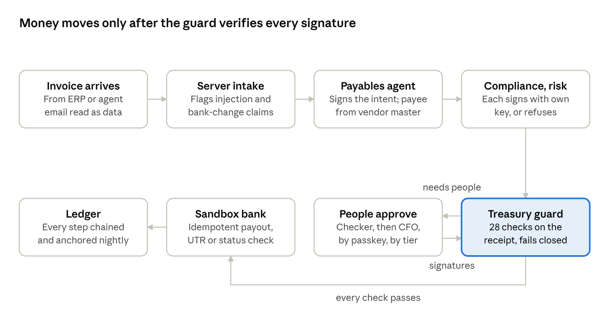
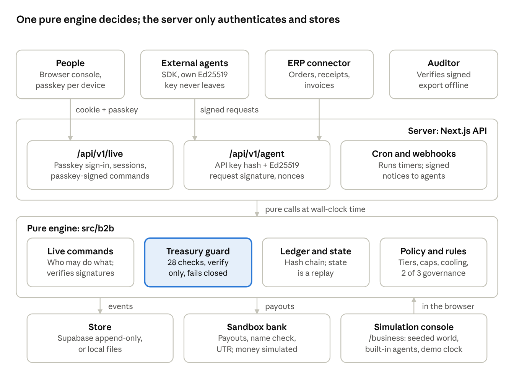

# Pakka for Business: Product Requirements Document

Oct 30, 2026 · Dhruv Dawar · Branch b2b-treasury

## Overview

Pakka for Business lets AI agents run a company's vendor payouts in rupees while making it impossible for any agent, email or single person to move money on their own. It is the B2B side of Pakka and shares no code paths with the consumer UPI AutoPay product.

**Problem.** Finance teams want AI to clear invoices, but an agent that controls payouts can be prompt-injected by a vendor email, fooled by a changed bank account, or run on a compromised host. Today's controls rely on trusting the agent's runtime or one person's key.

**Product.** Agents propose and sign payment intents. A treasury guard releases a payout only when it can verify, on its own, a receipt carrying three independent agent signatures, the passkey signatures the amount requires, and every policy check. The guard holds public keys only, so it can check signatures but never make them. Everything lands in a hash-chained ledger.

**Two modes.**

- **Simulation** (`/business`): two fictional companies over 26 to 28 Oct 2026, a seeded world, a demo clock and built-in agents. Used for the story and the 34-attack red team.
- **Live** (`/business/live`, `/api/v1`): a real company built from nothing. People sign in and approve with passkeys, external agents call the API with their own Ed25519 keys, ledgers persist on the server, and time is the wall clock. Only money is simulated, through a sandbox bank.

**Maturity.** Working prototype on branch `b2b-treasury`, pushed to GitHub. 88 business tests pass, the production build is clean, and the live flow has been run end to end against a dev server. Not yet tested on real phones' passkeys or a real Supabase project.

## Goals, non-goals and success metrics

The core claim holds and is measured: no payout has ever left without a receipt that passed every check, and no attack in either red team got through.

**Goals**

1. Receipt-gated payouts: nothing reaches the bank without a verified receipt bound to payee account, amount after TDS, invoices, nonce, policy and model.
2. Fail closed: any malformed input, verification error or missing signature blocks the payout.
3. No single point of trust: three independent agents plus people by amount; two of three governors for policy; one person can only tighten.
4. Resist the real B2B fraud: bank-detail change emails, prompt injection, split invoices, duplicate invoices, insider self-approval.
5. Evidence anyone can check: hash-chained ledger, signed export, offline verifier, attacks that are executed rather than claimed.
6. A real product surface: passkey sign-in, an agent API with an SDK, persistence and webhooks.

**Non-goals for this release**

- Moving real money or integrating a bank. Payouts, the name check and UTRs come from a sandbox.
- Zero-knowledge proofs. Receipts are signatures: they prove who signed exactly what, not how a model reasoned.
- A language model making money decisions. Models may only add reasons to escalate.
- Tax advice. TDS and GST rates are illustrative policy values.

**Success metrics**

| Metric | Target | Status |
| --- | --- | --- |
| Payouts without a passing receipt | 0 | 0, checked by invariants on every run |
| Simulation red team, attacks that got through | 0 of 34 | 0 of 34, executed in tests and the browser |
| Live red team on a real ledger | 0 of 12 | 0 of 12 on the demo company |
| Invoices paid more than once, nonces reused | 0 | 0 |
| Business test suite | 100% passing | 88 of 88 |
| Live ledger rebuilds to the same state | Always | Verified by replay tests and the offline verifier |
| Passkeys on real devices | Works on iOS, Android, macOS, Windows | Not yet tested |

## Users and use cases

Eight roles share one ledger; each can do only its own part, and no one can complete a payout alone.

| Role | Who | Can | Cannot |
| --- | --- | --- | --- |
| Governor (3) | Founder, directors | Invite people, register agents, change policy with a second governor, veto a looser policy, freeze, suspend an agent | Loosen policy alone, unfreeze alone |
| Maker | Accounts payable lead | Add vendors, request bank accounts, log the callback to the number on file | Approve payouts or bank accounts |
| Checker | Financial controller | Approve payouts from ₹50,000, approve verified bank accounts, freeze | Approve an account they opened or called about, then pay it within 30 days |
| CFO | Finance head | Second approval from ₹5,00,000, freeze, add sandbox money | Sign before the checker or fill two seats |
| Payables agent | External AI | Propose a payout for a matched invoice and sign it | Choose the payee: it always comes from the vendor master |
| Compliance and risk agents | External AI | Sign, refuse or escalate an intent | Propose, or sign twice |
| ERP connector | Customer's system | Push purchase orders, goods receipts and invoices | Sign anything |
| Auditor | Outside reviewer | Verify a signed export offline | Change anything |

**Key use cases**

1. **Small matched invoice:** the three agents sign and the guard pays within the agents' daily cap, with no person involved.
2. **Large invoice:** the guard asks for the checker, and from ₹5 lakh the CFO; each approves with a passkey after seeing exactly what they sign.
3. **Phishing email with a prompt injection:** the email is quarantined, its bank details open a change request, the ₹1 name check fails, the callback exposes it, and the real invoice is paid to the real account.
4. **New vendor:** the account passes the name check, the callback and the checker, then waits out the cooling period before its first, capped, payout.
5. **Compromised agent or host:** payouts still go only to accounts on file, within caps; a governor suspends the key at once.
6. **Policy change:** two governors sign; a looser rule waits 24 hours and any governor can veto it.
7. **Audit:** a governor exports the ledger signed with a passkey, and the auditor runs the verifier with no access to Pakka.
## How a payout is released

A payout leaves only when the guard has verified three agent signatures, the people the amount requires, and every policy check, using nothing but the receipt and the ledger.



payout release flow · 8 steps, people only when the tier needs them

If any check fails the guard blocks or holds the payout and writes why; waits such as cooling, the release window or a frozen company retry on their own. The guard's 28 checks, in order: not frozen, setup sealed, well formed, this company, planned in the ledger, not replayed, nonce issued, within lifetime, current policy, agent signatures valid, all three roles, no refusal, model allowed, payee on file, account matches, invoices open, amount exact after TDS, no open bank change, per-payout cap, rail fits, first-payout cap, people's signatures valid, everyone required signed, cooling, daily limit, payouts per vendor per day, release window, funds.

## Functional requirements

Every requirement below is built and tested on the branch; the live column says whether it also runs in the real system.

| ID | Requirement | Sim | Live |
| --- | --- | --- | --- |
| FR-1 | Payment intent binds company, vendor, account hash, amount, TDS, invoices, rail, nonce, policy hash, model hash, maker and expiry; its hash is what everyone signs | Yes | Yes |
| FR-2 | Payee always taken from the vendor master; an email can at most open a change request | Yes | Yes |
| FR-3 | Three agent roles sign with their own Ed25519 keys; one signature per role; a refusal holds the invoice | Yes | Yes, external agents over the API |
| FR-4 | Guard verifies the receipt alone and fails closed (28 checks, see the flow section) | Yes | Yes |
| FR-5 | Approval tiers on the vendor's 24 hour total: checker from ₹50,000, CFO from ₹5,00,000; agents alone capped per day | Yes | Yes |
| FR-6 | People approve by passkey (WebAuthn) over the exact intent; the guard re-verifies the assertion | PIN and device key | Yes |
| FR-7 | Segregation of duties: not your own payout, not an account you approved, one person one seat | Yes | Yes |
| FR-8 | Bank change needs a ₹1 name check of 80% or more, a callback to the number on file, and a checker who did neither; nothing is paid to that vendor while a change is open | Yes | Yes |
| FR-9 | Cooling: 24 hours for a new account, 72 for a changed one; first payout capped at ₹1,00,000 | Yes | Yes, founder may set starting rules before sealing |
| FR-10 | Three-way match, GSTIN check digit, exact and likely duplicates, TDS by category | Yes | Yes, server intake plus compliance agent |
| FR-11 | Email intake flags injection, bank changes, urgency, discouraged callbacks and sender mismatch, and quarantines instructions | Yes | Yes |
| FR-12 | Release window, daily limit, per-payout cap, payouts per vendor per day, rails, funds | Yes | Yes |
| FR-13 | Bank sandbox: idempotent payouts, pending and timeout status checks, failure refunds the balance and re-plans with a new nonce | Yes | Yes |
| FR-14 | Governance: two of three governors; looser changes timelocked 24 hours with veto; one person freezes, two unfreeze; suspend and reinstate agents | Yes | Yes |
| FR-15 | Live setup: create company with passkey, invite by single-use link, register agents, seal only when the team is complete | n/a | Yes |
| FR-16 | Offboarding: remove a person (two governors after sealing), revoke a lost passkey | n/a | Yes |
| FR-17 | Hash-chained ledger with nightly anchor; state is a replay of the ledger | Yes | Yes, persisted |
| FR-18 | Signed audit export and offline verifier | n/a | Yes |
| FR-19 | Red team executed on demand: 34 attacks in simulation, 12 on the live company's own ledger | Yes | Yes |
| FR-20 | Agent API with SDK, signed requests, work queues and signed webhooks | n/a | Yes |
| FR-21 | Console for every role: overview, payables with receipt inspector, approvals, bank changes, policy and keys, ledger, audit, red team, agent API | Yes | Yes |

## Security model and red team

Taking over one agent, all three agents, an API key, or one person's session still cannot send money to an account that is not on file or past the caps; every such attack is executed in tests and blocked.

**Trust boundaries**

- Untrusted: vendor emails and invoices, every agent and the host it runs on, the network between agents and server, API clients, any one person.
- Trusted: the guard code, the ledger's hash chain, registered public keys (agents' Ed25519, people's passkeys), two of three governors, the sandbox bank's answers.

**Defences by layer**

| Layer | Defence |
| --- | --- |
| Email and intake | Body read as data; injection, bank-change, urgency, no-call and sender checks; bank details only open a change request |
| Agents | Own keys; one signature per role; compliance and risk recompute from master data; registration needs governance after sealing; suspension is instant |
| Agent API | API key stored as a hash; Ed25519 signature over method, path, time, nonce and body hash; 5 minute window; single-use nonces; 240 requests per minute |
| People | Passkeys only in live mode; each write signed over the exact action and time; signatures single-use; checks origin, RP ID, user presence and verification |
| Sessions | 8 hour HttpOnly, SameSite=Strict signed cookie; Origin check on writes; sign-out revokes on the server; removed people locked out |
| Guard | Recomputes approval tier, caps and payee itself; verifies every signature; fails closed on any error |
| Ledger | Each event hashes the one before; nightly anchor; Supabase table refuses updates and deletes; append checks sequence and hash link |
| Browser | CSP, no framing of the approval screen, nosniff, no referrer, HSTS, passkeys allowed only on this origin |

**Red team, executed**

The simulation suite runs 34 attacks on fresh copies of the treasury, in `pnpm test` and in the browser in about 3 seconds. Tampering attacks first prove the untouched receipt passes, so a pass cannot come from a broken setup.

| Group | Attacks | Got through |
| --- | --- | --- |
| Receipt | Forged signature, amount raised, payee swapped, replay, invented nonce, expiry, cross-company, malformed, overpay with stolen keys | 0 of 9 |
| Agents | All three compromised, agents' daily cap, double vote, suspended key, unapproved model | 0 of 5 |
| Email | Prompt injection, bank change by email, change without callback, tampered GSTIN, goods not received | 0 of 5 |
| People | Self-approval, two seats, reused approval, freeze bypass, PIN guessing | 0 of 5 |
| Policy | New account at once, split payments, duplicates, stale policy, per-payout cap, one governor loosening | 0 of 6 |
| Bank | Timeout without resend, rejected payout, insufficient funds | 0 of 3 |
| Ledger | Edit the past | 0 of 1 |

The live red team runs 12 attacks on a private copy of the company's real ledger with attacker-made keys: forged and rogue agent signatures, amount and payee tampering, replay, fake passkey approval, cross-company replay, stretched expiry, acting as a governor, a phishing-site signature, ledger edits and an invented payout. All 12 were blocked on the demo company.

## Architecture and data

All decisions live in one pure TypeScript engine with no clock, randomness or I/O; the server authenticates callers, passes in the time, and appends the engine's new events to storage.



architecture · clients, server, pure engine, storage

The same engine runs the simulation in the browser and the live system on the server, so a ledger can always be replayed to the same state, by the server, the console or an auditor.

| Piece | Where | Notes |
| --- | --- | --- |
| Engine | `src/b2b` | world, policy, intent, agents (simulation), guard, ledger, state, commands, live, audit, red teams |
| Server | `src/lib/server/b2b`, `src/app/api/v1` | store, runtime (optimistic append with retry), auth, passkeys, handlers, webhooks |
| Agent SDK | `src/sdk/pakka-agent.ts` | signs requests and attestations, verifies webhooks |
| Reference agents | `scripts/agents/pakka-agents.ts` | payables, compliance, risk; optional model reads emails, can only escalate |
| Consoles | `/business`, `/business/live` | simulation store in the browser; live client replays the server's ledger |
| Storage schema | `supabase/migrations/0002_b2b.sql` | `b2b_orgs`, `b2b_events` (append-only, chain-checked), `b2b_once` (single-use values) |

**Ledger event.** Every event carries `seq`, `at`, `companyId`, `type`, `actor`, `ruleId`, `payload`, `prev` (hash of the previous event) and `hash`. Registry events build a live company from nothing: `org_created`, `person_invited`, `person_registered`, `agent_registered`, `org_sealed`, `vendor_registered`, `po_created`, `grn_created`, `invoice_submitted`. Payment events record each step: `intent_proposed`, `attested`, `approval_needed`, `approved`, `guard_blocked`, `payout_submitted`, `payout_settled`.

**Hashes and signatures.** SHA-256 over canonical JSON (sorted keys, integers only) with a domain tag per kind: intent, attestation, approval, governance, action, request, export, ledger. Agents sign with Ed25519; people with passkeys (P-256 or Ed25519), verified against the raw public key stored at registration.

## Policy defaults and rules

The default policy below is version 1 for every company; any change needs two governors, and a looser value waits 24 hours. Whether a change is looser is computed field by field, never taken from the proposer.

| Setting | Default |
| --- | --- |
| Per-payout cap | ₹10,00,000 |
| Daily limit | ₹30,00,000 |
| Agents alone, per day | ₹3,00,000 |
| Checker from (vendor's 24 hour total) | ₹50,000 |
| CFO from (vendor's 24 hour total) | ₹5,00,000 |
| First payout to a new account | ₹1,00,000 |
| Cooling, new account / changed account | 24 hours / 72 hours |
| Approval lifetime; account approver barred from paying that account | 8 hours; 30 days |
| Intent lifetime | 12 hours |
| Payouts per vendor per day | 4 |
| New bank accounts per day | 2 |
| Release window (IST) | 9 AM to 7 PM |
| Rails | IMPS up to ₹5,00,000, RTGS from ₹2,00,000, NEFT any |
| TDS (illustrative) | Goods 0, logistics 2%, services 10%, rent 10% |
| MSME payment deadline | 45 days, alert from day 40 |

Every money action and every block carries a rule ID from this catalogue:

| Rule | What it means |
| --- | --- |
| `PAYOUT_AGENTS_V1` | Small matched payout, agent quorum only |
| `PAYOUT_CHECKER_V1` | Payout approved by a checker |
| `PAYOUT_CFO_V1` | Payout approved by a checker and the CFO |
| `RECEIPT_V1` | Every payout carries a receipt the guard checks before money moves |
| `HOLD_MATCH_V1` | Invoice does not match the order and the goods received |
| `HOLD_DUPLICATE_V1` | Invoice already paid or accepted |
| `HOLD_GSTIN_V1` | GSTIN invalid or not the vendor's |
| `INJECTION_QUARANTINE_V1` | Instructions in an email are data, never obeyed |
| `BANK_CHANGE_VERIFY_V1` | Name check, callback to the number on file and a checker |
| `COOLING_V1` | New or changed account waits before its first payout |
| `FIRST_PAYMENT_CAP_V1` | First payout to a new account is capped |
| `STRUCTURING_V1` | Payouts to one vendor in 24 hours are added up |
| `AGENT_CAP_V1` | Agents alone may release only a fixed amount per day |
| `RELEASE_WINDOW_V1` | Payouts leave only inside the release window |
| `MSME_45_V1` | MSME vendors are paid within 45 days |
| `BANK_STATUS_V1` | A payout with unknown status is checked, never resent |
| `RETRY_AFTER_FAIL_V1` | A failed payout is planned again with a new nonce |
| `DAILY_LIMIT_V1` | Daily payout limit |
| `SOD_V1` | No one approves what they prepared or an account they approved |
| `GOVERNANCE_V1` | Policy changes need two of three governors |
| `TIMELOCK_V1` | A looser policy waits 24 hours and can be vetoed |
| `FREEZE_V1` | Payouts frozen |
| `KEY_SUSPEND_V1` | A suspected agent key is suspended |

## Testing, demo and how to run

88 business tests cover the engine, the live command layer, the HTTP API with real passkey registration, and both red teams; all pass, and the production build is clean.

| Test file | Covers |
| --- | --- |
| `world.test.ts` | Seeded world is deterministic, fixed counts, integer paise, valid GSTINs, distinct keys |
| `crypto.test.ts` | Canonical encoding, signatures, GSTIN check digit, loosening rules, tiers |
| `intake.test.ts` | Injection and bank-change detection, clean emails, duplicates |
| `story.test.ts` | Three-day simulation reproduces its numbers and every invariant; replays to the same ledger |
| `redteam.test.ts` | All 34 simulation attacks |
| `architecture.test.ts` | Guard never imports signing keys, engine is pure, no dashes |
| `live.test.ts` | Live setup from nothing, payout end to end, forged and stale signatures, sealing, governance, offboarding, audit export, live red team |
| `api.test.ts` | Company creation and sign-in by passkey through @simplewebauthn, invites, agents over the SDK, replayed and tampered requests, single-use signatures, sign-out revocation, webhooks, payout over HTTP |

**Simulation story (seed 2711).** Saanjh Distributors: 41 invoices, 37 paid (24 by agents alone, 13 with a checker, 1 with the CFO), 2 held, 2 rejected as duplicates, 1 fraud attempt stopped (₹4,19,905), 1 MSME alert, 0 payouts without a passing receipt. Kaveri Fresh: 8 of 8 paid.

**Run it**

```bash
pnpm dev
pnpm b2b:live-demo
pnpm agents run --listen 4100
pnpm agents erp-demo erp v_1 --gstin=<printed GSTIN> --phish
pnpm b2b:live-demo approve
pnpm b2b:verify <export.json>
```

`b2b:live-demo` sets up a sealed company over HTTP with six people, four agents and a verified vendor. `agents run` starts the reference payables, compliance and risk agents. `erp-demo` pushes an order, a goods receipt and an invoice, optionally with a phishing email. `b2b:story` prints the simulation's outcome per invoice. The simulation is at `/business` and the live console at `/business/live`.

**Production settings:** `PAKKA_SESSION_SECRET`, `PAKKA_ORIGINS` (and `PAKKA_RP_ID` if it differs), `NEXT_PUBLIC_SUPABASE_URL` and `SUPABASE_SERVICE_ROLE_KEY` with migration `0002_b2b.sql`, and `CRON_SECRET` for `/api/v1/live/cron`.

## Known gaps, risks and next steps

The biggest gap is that nothing has run on real devices or real infrastructure yet; everything else is a known, bounded limitation.

| Gap or risk | Impact | Next step |
| --- | --- | --- |
| Passkeys tested only with a software authenticator | A device-specific bug could block sign-in or approvals | Test on iPhone, Android, Mac and Windows; check synced passkeys |
| Supabase store never run against a real project | Migration or append function could fail in production | Run `0002_b2b.sql` on a staging project and replay the demo |
| Money is a sandbox | No real settlement, name check or UTR | Integrate a payouts provider behind the same guard and idempotency key |
| Receipts are signatures, not zero-knowledge proofs | Proves who signed what, not model reasoning | Keep the claim honest; consider ZK only if a verifier outside the company needs it |
| Webhooks are best effort | A missed notice delays work until the agent polls | Add a retry queue with backoff |
| Rate limits and nonce checks are per server instance in memory, nonces persisted in the store | Limits are loose across many instances | Move rate limits to the store or an edge limiter |
| Governors are fixed after sealing | A departing governor cannot be replaced | Design a three-of-three or timelocked replacement flow |
| A governor revoking someone's last passkey locks them out | They must be invited again as a new person | Add a recovery flow tied to a second governor |
| Demo starting rules turn off cooling and the release window | Weaker than production defaults | Use standard rules for any real company |
| No language model in the business engine | Email reading is rule-based on the server | Optional model reader that may only add evidence |

**Open questions**

- Which payouts provider, and does it give a name check and status API we can map to the sandbox's?
- Do governors need to be replaceable, and under what quorum?
- Should auditors get a read-only role in the console, or only the signed export?
- Is one company per ledger right for groups with many entities?
